# COMP 3613 Assignment 2 — Student Awards

## Project Description

Student Awards is a web-based incentive system for student volunteering. Students submit volunteer hours for administrator review, track approved hours and leaderboard rankings, and redeem awards when they meet the required-hour thresholds. Administrators approve or reject pending submissions; approved hours update student totals and progress. The application uses FastAPI, SQLModel, server-rendered HTML views, and a layered route/service/repository/model structure.

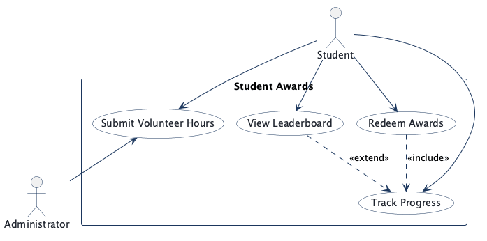

**Use Case Diagram**

Students submit volunteer hours, track progress, view the leaderboard, and redeem awards. Administrators review submissions by approving or rejecting them. Viewing the leaderboard is optional after tracking progress; redeeming an award includes checking progress.

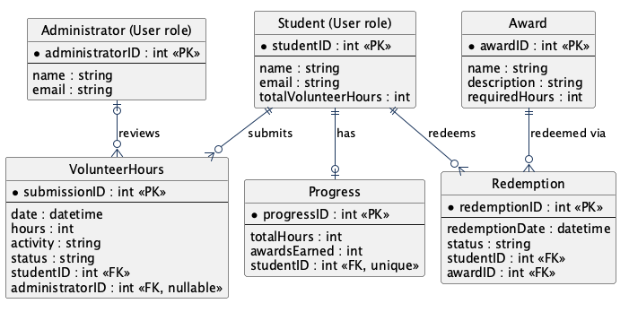

**Entity Relationship Diagram**

Student and Administrator denote role-specific User records in the implementation. A student may have no Progress row until their first approved submission; each existing Progress row belongs to one student. Pending VolunteerHours rows have no reviewing administrator; after approval or rejection, the row references the reviewing administrator.

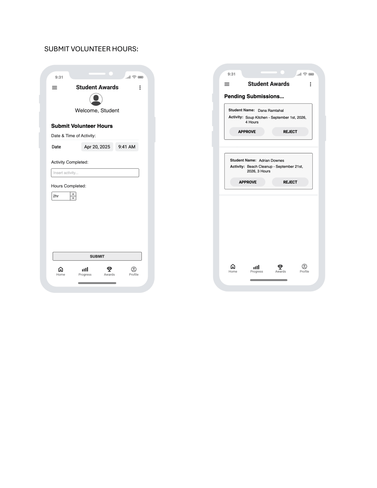

**Application Wireframe — Submit Volunteer Hours**

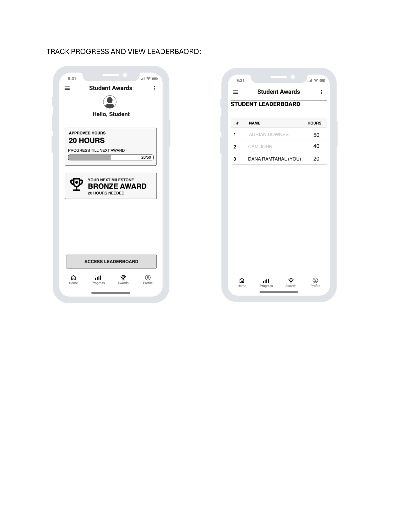

**Application Wireframe — Track Progress and View Leaderboard**

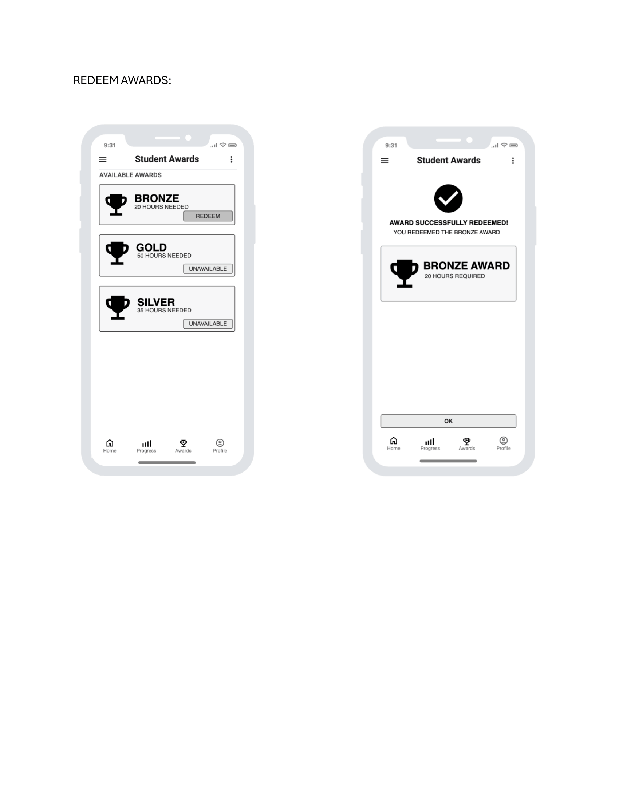

**Application Wireframe — Redeem Awards**

## Test Plans

### User Acceptance Test Plan and Completed Report

The scenarios are based on the application wireframes. Actual results and PASS outcomes below are the recorded UAT results.

### UAT-01 — Submit Volunteer Hours

- **Role:** Student
- **Expected:** The student sees a success message and the administrator's pending list shows the new submission.
- **Actual:** The student successfully submitted 5 volunteer hours for a community clean-up activity and received a success message.
- **Result:** PASS

### UAT-02 — Administrator Approves Volunteer Hours

- **Role:** Administrator, then Student
- **Expected:** The submission is no longer pending and approved hours increase by the submitted amount.
- **Actual:** The administrator approved the 5-hour Community clean-up submission. The submission disappeared from the pending submissions list.
- **Result:** PASS

### UAT-03 — Reject a Pending Submission

- **Role:** Administrator, then Student
- **Expected:** The submission is no longer pending and the student's approved-hours total does not increase because of the rejection.
- **Actual:** The administrator rejected the pending volunteer-hours submission. It disappeared from the pending submissions list, leaving no pending submissions.
- **Result:** PASS

### UAT-04 — View Progress and Next Milestone

- **Role:** Student
- **Expected:** The page displays the student's current approved hours and, when applicable, the next unredeemed award milestone.
- **Actual:** The student's total volunteer hours increased to 10 hours after the administrator approved the 5-hour Community clean-up submission.
- **Result:** PASS

### UAT-05 — View Leaderboard

- **Role:** Student
- **Expected:** Students appear in descending approved-hours order; the administrator is excluded and the signed-in student is marked.
- **Actual:** The leaderboard displayed bob in first place with 10 volunteer hours. Other students with 0 hours appeared below him.
- **Result:** PASS

### UAT-06 — Redeem an Eligible Award

- **Role:** Student
- **Expected:** The eligible award can be redeemed and is then displayed as redeemed.
- **Actual:** The student reached 20 approved volunteer hours, making the Bronze Award eligible for redemption. The student clicked Redeem and the application displayed 'Redeemed', confirming the award was successfully redeemed.
- **Result:** PASS

### UAT-07 — Attempt to Redeem an Unavailable Award

- **Role:** Student
- **Expected:** An ineligible or already redeemed award cannot be redeemed.
- **Actual:** The Bronze, Silver and Gold awards were marked as unavailable because the student had only 10 approved volunteer hours. The redemption buttons were disabled, preventing the student from attempting to redeem an award.
- **Result:** PASS

**Separate award test scenarios:** UAT-06 and UAT-07 used different test states. For UAT-06, the student had 20 approved volunteer hours, making the Bronze Award eligible for redemption. For UAT-07, a separate test state had 10 approved volunteer hours, so the awards remained unavailable.

The UAT outcomes are the recorded user observations. The automated test screenshots in this report are separate from the UAT evidence.

### Unit Test Plan

The application seeds Bronze, Silver, and Gold with thresholds of 20, 35, and 50 approved hours, respectively. Test descriptions that use other values refer to test-specific awards, not the seeded award catalog. The unit tests use fake repositories, session objects, templates, and services. They do not use the SQLite integration fixture or connect to the configured application database. The descriptions below reflect the assertions made by the current test functions.

- **`test_submit_hours_adds_pending_submission()`** — Checks pending status, student ID, hours, activity, and that the fake repository stores the returned submission; it does not assert the date.
- **`test_approve_updates_submission_and_totals()`** — Checks approved status, administrator ID, student total 10→18, progress total 15→23, and a fake-session add; it does not assert commit or persisted state.
- **`test_approve_raises_value_error_for_missing_submission()`** — Expects `ValueError` matching `Submission not found`.
- **`test_reject_marks_submission_rejected()`** — Checks rejected status, administrator ID, and a fake-session add; it does not assert unchanged student/progress totals.
- **`test_get_available_awards_marks_eligible_and_not_redeemed()`** — Checks an award above its threshold is available and not already redeemed.
- **`test_get_available_awards_marks_redeemed_and_ineligible()`** — Checks an under-threshold award that is also listed as redeemed is unavailable and already redeemed; the two conditions are combined.
- **`test_redeem_raises_for_missing_award()`** — Expects `ValueError` matching `Award not found`.
- **`test_redeem_raises_for_duplicate_redemption()`** — Expects `ValueError` matching `already redeemed` when the award ID is already redeemed.
- **`test_get_leaderboard_assigns_rank_and_current_student()`** — Checks first-row rank, name, hours, and current-student flag, plus the second row's non-current flag; fake rows are already ordered.
- **`test_get_progress_returns_next_award_and_threshold()`** — Checks the returned progress object, next unredeemed test award, and test-specific threshold of 25 hours (not the seeded Silver threshold).
- **`test_submit_action_renders_value_error_message()`** — A fake service raises `ValueError("invalid submission")`; checks HTTP 400, the `submit_hours.html` template, and the error context text.

### Integration Test Plan

Integration tests use SQLModel records and the shared `session` fixture, which creates a temporary SQLite database under `tmp_path`; they do not connect to the deployed database. The descriptions below reflect the assertions made by the current test functions.

- **`test_submit_hours_creates_pending_submission()`** — Reads the created record and checks existence, pending status, student ID, and 5 hours; not date or activity.
- **`test_approve_submission_updates_student_and_progress()`** — Checks approved status, stored student total of 8, progress total of 8, and zero awards earned; not administrator ID.
- **`test_approve_submission_creates_progress_when_missing()`** — Checks approval and creation of a Progress row with 8 hours and zero awards earned.
- **`test_approve_submission_rejects_duplicate_review()`** — Checks a second approval raises `ValueError` matching `already been reviewed`; not post-error totals.
- **`test_approve_missing_submission_raises_value_error()`** — Expects `ValueError` matching `Submission not found`.
- **`test_reject_submission_sets_rejected_status()`** — Checks rejected status and administrator ID 7; not unchanged totals.
- **`test_reject_missing_submission_raises_value_error()`** — Expects `ValueError` matching `Submission not found`.
- **`test_pending_submissions_include_student_names()`** — Checks two rows, expected student names, and expected pending activities; it does not directly assert the reviewed row's absence by ID/status.
- **`test_get_available_awards_eligible_and_unredeemed()`** — Checks an above-threshold, unredeemed award is available and not already redeemed.
- **`test_get_available_awards_marks_ineligible_and_redeemed()`** — Checks an under-threshold award that is also redeemed is unavailable and already redeemed; these conditions are combined.
- **`test_redeem_award_creates_redemption_and_updates_progress()`** — Checks returned redemption status/student ID and persisted `Progress.awardsEarned == 1`; not an independent query for the redemption row.
- **`test_redeem_award_does_not_create_missing_progress()`** — Checks returned redemption is completed and no Progress row exists afterward; not an independent query for a saved Redemption row.
- **`test_redeem_award_rejects_insufficient_hours()`** — Expects `ValueError` matching `You need`; not database state afterward.
- **`test_redeem_award_rejects_duplicate()`** — Checks a second redemption raises `ValueError` matching `already redeemed`; not the number of redemption rows afterward.
- **`test_leaderboard_excludes_admins_and_orders_students_by_hours()`** — Checks returned names/order, first-row rank, and current-student flag; seeded names/order exclude the admin, but not all displayed hour values or tie handling.
- **`test_get_progress_returns_next_unredeemed_award()`** — Checks progress total 30 and that the next award and threshold are `None` when the only award is redeemed.
- **`test_get_progress_returns_first_unredeemed_award()`** — Checks the test award named Silver is selected after Bronze is redeemed and the test-specific threshold is 25 hours (not the seeded Silver threshold of 35); not the returned progress object or total.

## Implementation

The application implements the Student Awards student and administrator workflows using FastAPI views and SQLModel-backed services and repositories. Authenticated student routes cover volunteer-hour submission, progress, leaderboard, and awards. Administrator-only routes cover pending-submission review. Service logic applies approval, progress, leaderboard, award-eligibility, and redemption rules; routers handle request binding, access dependencies, rendered responses, and redirects.

The workflow views use `GET` for displaying pages and `POST` for submissions and actions. Form actions that complete through navigation redirect back to the relevant page. The student and administrator pages are protected by their respective authentication dependencies.

### Deployed Application

[https://comp3613a1-pln2.onrender.com](https://comp3613a1-pln2.onrender.com)

Demo accounts: `bob / bobpass` (student) and `admin / adminpass` (administrator).

### GitHub Repository

[https://github.com/DanaRPR/comp3613a1](https://github.com/DanaRPR/comp3613a1)

### Test Implementation and API Test Collection

- **Unit tests:** 11 pytest tests in `tests/unit/`.
- **Integration tests:** 17 pytest tests in `tests/integration/`.
- **CLI command:** `PYTHONPATH=. PYTHONDONTWRITEBYTECODE=1 .venv/bin/pytest -p no:cacheprovider -q`
- **2026-11-10:** 11 unit + 17 integration tests; 28 passed, 0 failed, 0 skipped.
- **Postman collection:** [student-awards-api-tests.postman_collection.json](../postman/student-awards-api-tests.postman_collection.json), exported as a Postman Collection v2.1 JSON file with 21 requests. It covers login and registration, student and administrator pages/actions, form validation, and access-control responses.
- **Postman run evidence:** The saved collection-run screenshots show 24 passed, 0 failed, and 0 errors. Postman was not rerun for this PDF revision.

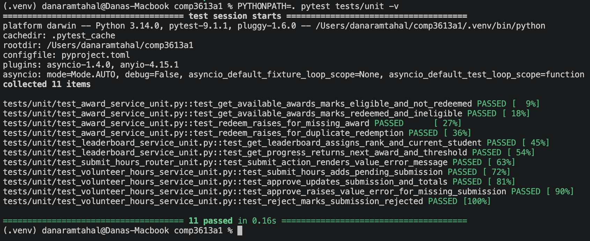

**Unit Test Report**

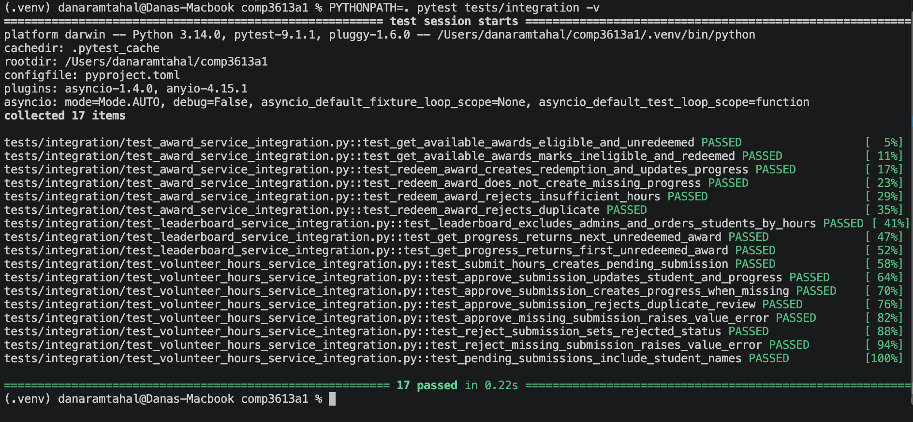

**Integration Test Report**

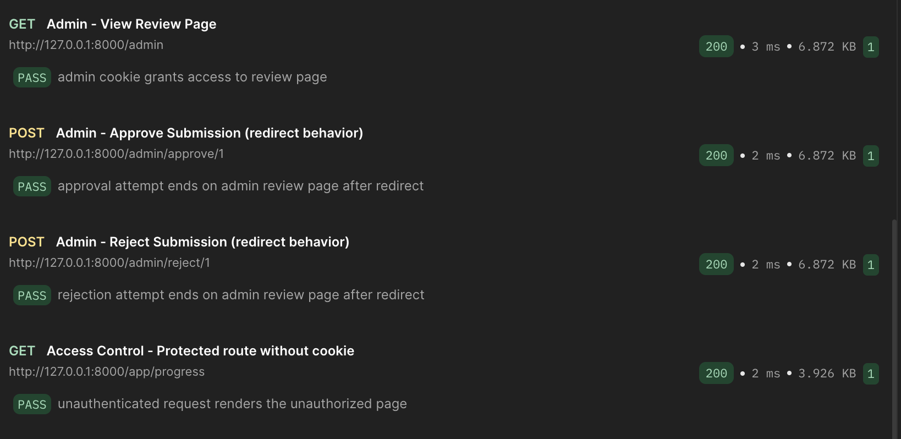

**Postman Collection Run Report**

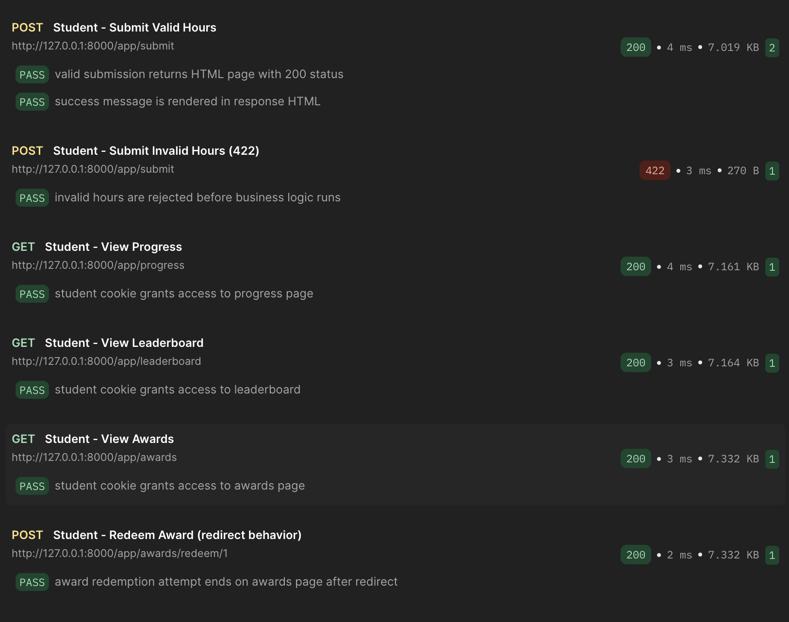

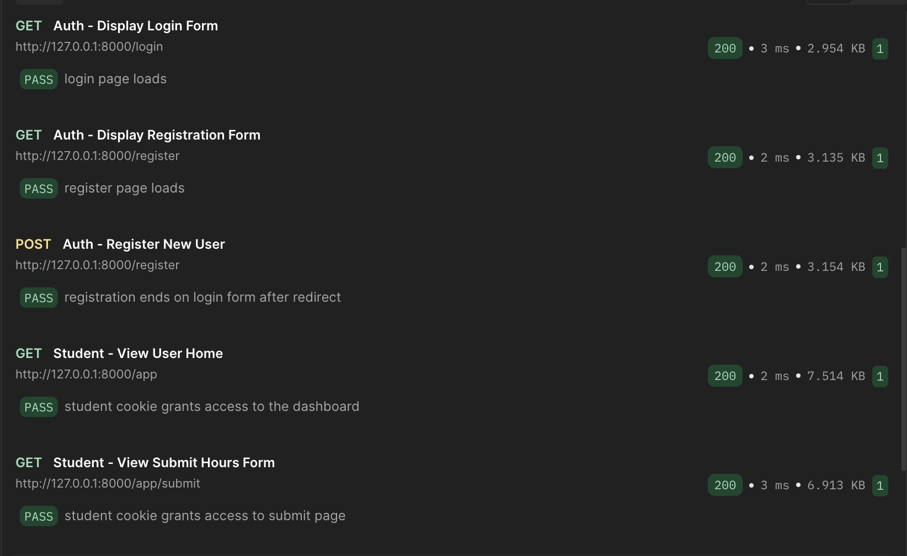

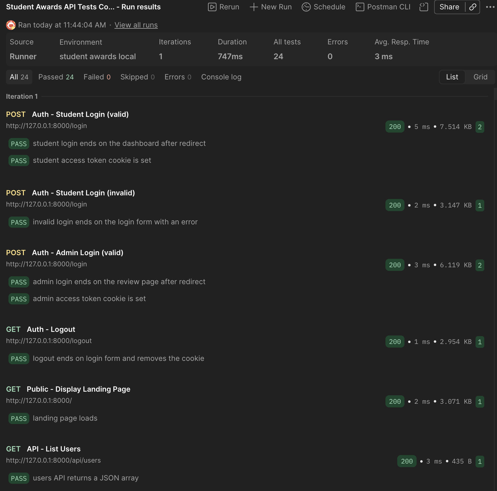
