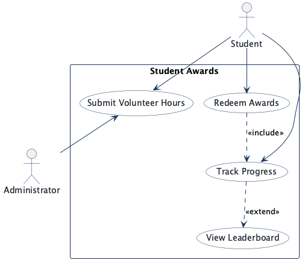
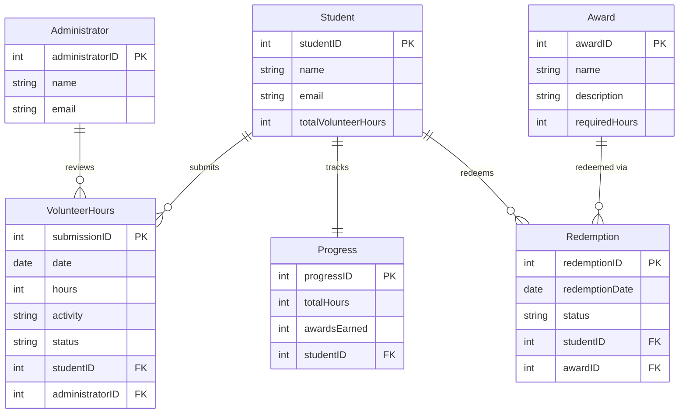
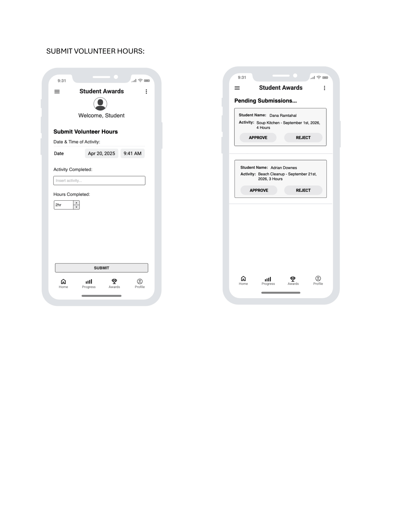
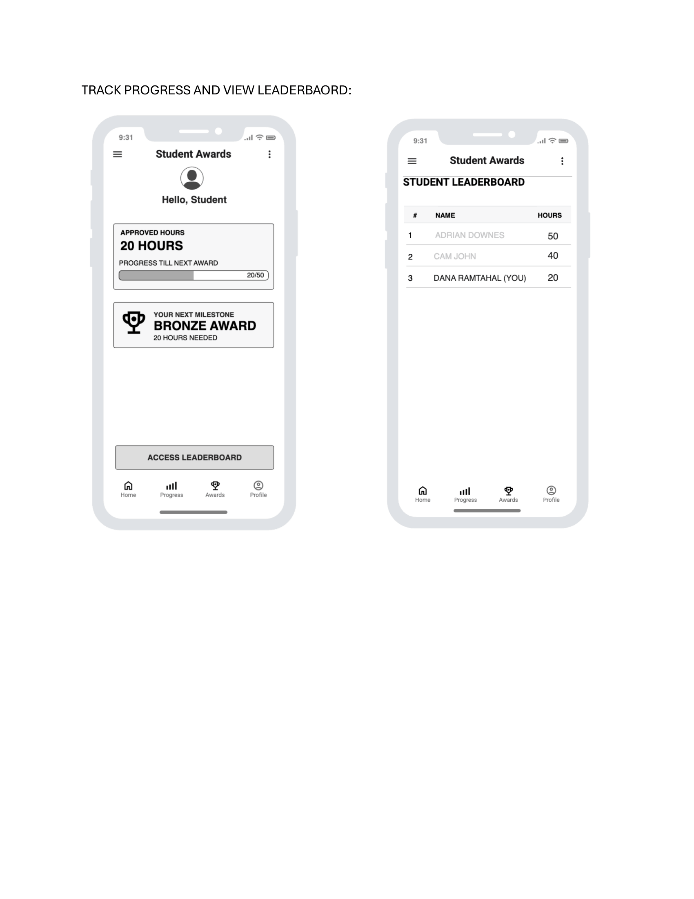
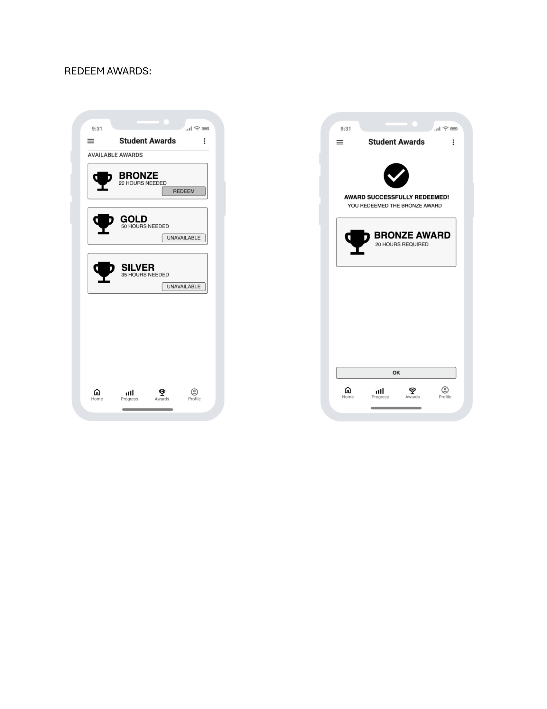

<!-- student-build:skill-integrity
status: pass
root: e84cd692d0b85eefe546385661958c27d07e8be6c5176a82012f68ccff5c8beb
expected_root: e84cd692d0b85eefe546385661958c27d07e8be6c5176a82012f68ccff5c8beb
mismatches: none
-->

# COMP 3613 Assignment 1

Draft this file with the Guide. **Update it after every phase milestone** before you pause. The use-case diagram is a UML PNG at `docs/diagrams/use-case.png`, linked from this file as `diagrams/use-case.png` (path relative to `docs/report.md`). The model diagram is Mermaid. **Embed wireframe images** as `wireframes/<file>` (files live in `docs/wireframes/`).

Do not put your student ID in this file if you will commit it. The PDF cover adds your name and ID at export time.

## Assigned project

Student Awards (incentive system)

## Three workflows

### 1. Submit volunteer Hours (Student)

### 2. Track Progress and View Leaderboard (Student)

### 3. Redeem Awards (Student)

## Use case diagram

Student and Administrator share **Submit Volunteer Hours** (student submits; administrator approves or rejects). **View Leaderboard** `«extend»`s **Track Progress** (optional). **Redeem Awards** `«include»`s **Track Progress** (always required). Track Progress, View Leaderboard, and Redeem Awards are Student-only.

## Model diagram

Phase 4 revision: removed `Award.points`, `Progress.pointsEarned`, and `Leaderboard.totalPoints` — hours drive rankings and eligibility. Leaderboard is a derived view, not a stored table.

## Wireframes

### Submit Volunteer Hours (Student + Admin)

### Track Progress and View Leaderboard

### Redeem Awards

### Coverage

<!-- student-build:wireframe-coverage
use_case: Submit Volunteer Hours
image: docs/wireframes/wireframe final-1.png
covered: yes
-->

<!-- student-build:wireframe-coverage
use_case: Track Progress and View Leaderboard
image: docs/wireframes/wireframe final-2.png
covered: yes
-->

<!-- student-build:wireframe-coverage
use_case: Redeem Awards
image: docs/wireframes/wireframe final-3.png
covered: yes
-->

### wireframe final 1

### wireframe final 2

### wireframe final 3

## Theming

**Wordmark:** Student Awards (no logo)
**Font:** Inter (professional sans-serif)
**Tone:** Professional but encouraging
**Colors:**
- Navy blue primary (`#1e4d8c` accent, `#0f1b2d` background)
- Neutral surface (`#f4f5f7`) and ink (`#1c2a3a`)
- Green (`#2e7d5b`) for approve actions
- Red (`#c0392b`) for reject actions
- Bronze (`#b07d4f`), Silver (`#9aa5b1`), Gold (`#d4a843`) for award tiers

**Applied to:** landing (`/`), login, register, authenticated sidebar. Brand tokens set in `app/static/css/app.css`. Starter demo pages removed.

## Implementation notes

### Workflow 1: Submit Volunteer Hours (Student)

**Status:** Done

**Implementation notes:**
- SQLModel: `VolunteerHours` model with date, hours, activity, status (default "pending"), student_id FK, administrator_id FK (nullable).
- Thin route: `/app/submit` GET renders form; POST binds form data, constructs Repository + Service, calls `service.submit_hours()`. No SQL in route.
- Service creates submission with status "pending". Admin approve updates status, increments `User.totalVolunteerHours`, creates `Progress` on first approval.
- Model revision: added `totalVolunteerHours` to User (was missing from ERD); added `Progress` model.

**Verify notes:** Student ran app, submitted form via sidebar "Submit Hours" link, received success message. Form matches wireframe.

**Admin approval (completes Workflow 1):** Admin home page shows pending submissions with APPROVE/REJECT buttons (green/red per theming). Approve updates status, increments student hours, creates Progress. Student sees updated hours on Progress page. Verified end-to-end.

### Workflow 2: Track Progress and View Leaderboard (Student)

**Status:** Done

**Implementation notes:**
- Thin routes: `/app/progress` and `/app/leaderboard` construct LeaderboardRepository + LeaderboardService, call service methods, pass results to template. No SQL in routes.
- Leaderboard is derived — repository queries User ordered by totalVolunteerHours, service builds ranked list with is_current flag.
- Progress page shows approved hours, progress bar, "Access Leaderboard" button.
- Leaderboard page shows ranked table with current user highlighted.

**Verify notes:** Student saw 0 approved hours and bob on leaderboard (fresh account). Correct behaviour.

### Workflow 3: Redeem Awards (Student)

**Status:** Done

**Implementation notes:**
- Thin routes: `/app/awards` and `/app/awards/redeem/{award_id}` construct AwardRepository + AwardService, call service methods, redirect after redeem. No SQL in routes.
- Hours stay after redemption — award is a milestone marker (student choice).
- Service checks eligibility (hours >= requiredHours, not already redeemed), creates Redemption, increments Progress.awardsEarned.
- Awards seeded: Bronze (20h), Silver (35h), Gold (50h).
- Template shows REDEEM (gold button) / UNAVAILABLE / REDEEMED states per wireframe.

**Verify notes:** Student saw Bronze as REDEEMED after redeeming. Correct behaviour.

### Polish

- Added "Your Next Milestone" card to Progress page (was missing from wireframe).
- Progress bar now computes the actual next unredeemed award threshold instead of hardcoded 50.
- Fixed: awards were not seeded until re-running `python manage.py init` after adding award seeding to CLI.

## Deployed app

Phase 6. Public Render URL (not localhost). Markers open this to mark the three workflows.

https://comp3613a1-pln2.onrender.com

## Logins

Every account a marker needs, including extra users you added. Starter accounts:

- bob / bobpass — regular user
- admin / adminpass — admin

## YouTube URL

https://youtu.be/7t-L2V9G9eM

## GitHub

https://github.com/DanaRPR/comp3613a1

## Agent used

OpenCode (mimo-v2.6-flash-free) with student-build skill. Phases 1–3 used Cursor.

## Account email

dana.ramtahal@my.uwi.edu

## Session transcripts

Filled when the Guide builds the report: the agent writes chat markdown into `docs/transcripts/`; `python manage.py report` packages them.

Guide packaged **6** chat(s) in `docs/transcripts/` (and `docs/transcripts.zip`).

Index: [docs/transcripts/INDEX.md](transcripts/INDEX.md)

- [`phase-1-workflows`](transcripts/phase-1-workflows.md)
- [`phase-2-use-case`](transcripts/phase-2-use-case.md)
- [`phase-3-model`](transcripts/phase-3-model.md)
- [`phase-3.1-model`](transcripts/phase-3.1-model.md)
- [`phase-4-wireframes`](transcripts/phase-4-wireframes.md)
- [`phase-5-implement-polish`](transcripts/phase-5-implement-polish.md)

## Competency (student-judge)

Filled by Guide from the student-judge run when this report was built.

**Judged at:** 2026-10-12T13:00:00
**Evidence pass:** re-read native chats + current docs/report.md (prior judge.md ignored)

# student-judge competency report

**Student / session:** Student Awards — COMP 3613 Assignment 1
**Artifact:** Guide chats for this project (Cursor + OpenCode) and `docs/transcripts/` dump
**Phases in evidence:** 1–6 (COMP 3613; Phase 5 polish, Phase 6 deploy)

### Totals
| | Count / value |
|--|--|
| Metrics on rubric | 12 (M1–M12) |
| N/A (excluded) | 0 |
| Metrics scored | 12 |
| Scoreable max | 48 |
| Awarded total | 45 / 48 |
| **Overall (avg of scored)** | **3.75 / 4** |
| Impression mark | 17 / 20 |

## Scorecard

| ID | Metric | Score / 4 | In avg | Evidence |
|----|--------|----------:|:------:|----------|
| M1 | Phase discipline | 3 | yes | Each design phase in its own chat; Phase 5 theme→build→polish before Phase 6; no app code before wireframes. Minor: Phase 3 split across Cursor + OpenCode due to usage limit. |
| M2 | Problem framing | 4 | yes | "Student Awards" + three `Feature (user)` lines; answered include/extend ("view leaderboard is optional after track progress", "it is always required"); identified Administrator; "Submit Volunteer Hours is shared by the Student and Administrator". |
| M3 | Decision ownership | 4 | yes | Chose project, workflows, relationships ("1 award can be redeemed many times…each redemption is for one award"), corrected own wireframe ("that was a mistake, i updated the wireframe"), chose hours over points, chose "b" (progress on first approval), "a" (all students on leaderboard), "a" (hours stay). |
| M4 | Artefact-before-code | 4 | yes | Implemented ERD + wireframes as spec; requested home page to match wireframe; model revised when wireframes showed hours-only ranking. |
| M5 | Verification habit | 3 | yes | Verified each workflow after Guide asked: "yes i got that message anc yes the form matches the wireframe", "1. I got the approval message…5. i see the progress hours", "yes i see bronze as redeemed". Some notes brief but present. |
| M6 | Assignment fit | 4 | yes | Thin routes → services → repositories → models throughout; reused FastStarter auth/nav; theme applied to landing/login/register; deployed to Render. No SQL in routers. |
| M7 | Slice explanation | 4 | yes | Completed SQLModel + thin route snippets for all 3 workflows; all `architecture_ok: yes`; explained choices in own words; code-checks passed. |
| M8 | Prompt quality | 4 | yes | Phase-tagged prompts; "The Student home page still shows the starter text…Can you replace it with a welcome message and 3 cards linking to submit hours, progress and rewards? Don't change anything else" — concrete, scoped polish request. |
| M9 | Response to pushback | 4 | yes | When Guide flagged missing milestone card: "yes" → verified fix ("okay i see it now"). After deploy: requested home page replacement. Kept refining beyond first build. |
| M10 | Integrity | 4 | yes | No suspicion flags; no paste-back; no skill edits; all decisions in own words. |
| M11 | Provenance continuity | 4 | yes | Solutions grew from this thread's workflows, model, and wireframes; no orphan code. |
| M12 | Sincerity trajectory | 4 | yes | No suspicion needed; consistent honest engagement across all phases. |

## Strengths
- Student named the project and three workflows, answered include/extend and shared-use-case questions, and identified the Administrator role through edge-case reconsider.
- Owned all relationship choices and corrected own wireframe when Guide flagged a mismatch (25→20 hours).
- Completed SQLModel and thin route snippets for all three workflows with `architecture_ok: yes` — routes call services, no SQL in routers.
- Verified every workflow after Guide asked and reported what they saw.
- Steered polish: accepted milestone card fix, requested home page replacement after deploy.
- Deployed to Render with URL and marker logins in report.

## Gaps (priority order)
1. Some verify notes were brief ("it looks good", "everything looks good") — solid but not detailed mismatch hunting. Minor; per-workflow notes were still present.

## Phase gate status
| Phase | Status | Note |
|-------|--------|------|
| 1 | met | Project + 3 `Feature (user)` lines in student's words |
| 2 | met | UML PNG drafted; include/extend, shared use case, Administrator gap all answered |
| 3 | met | Student-named entities/properties; relationships owned; Mermaid ERD drafted |
| 4 | met | 3 wireframes embedded; model revised (points removed); coverage blocks present |
| 5 | met | Theme applied; 3 workflows built with snippets; polish engaged (milestone card, home page) |
| 6 | met | Render URL + marker logins in report |

## Recommended next practice
- When verifying, note specific UI details that differ from the wireframe (spacing, labels, colours) rather than "looks good" — this builds mismatch-hunting habit.

## Integrity note
- Clean
## Provenance flags
- None
## Sincerity log summary
- Blocks found: 0 | max round: N/A | min/mean/final confidence: N/A | trend: N/A | cleared: N/A (no suspicion raised)
## Skips
- Skips: 0/3 used (from Guide). Skips are not an integrity failure.

## Skill integrity

Course skills are hashed at export and compared to `.agents/skills.lock.json`. Do not edit `.agents/skills/`, `.cursor/skills/`, or `AGENTS.md`.

- Status: **pass**
- Root: `e84cd692d0b85eefe546385661958c27d07e8be6c5176a82012f68ccff5c8beb`
- none
