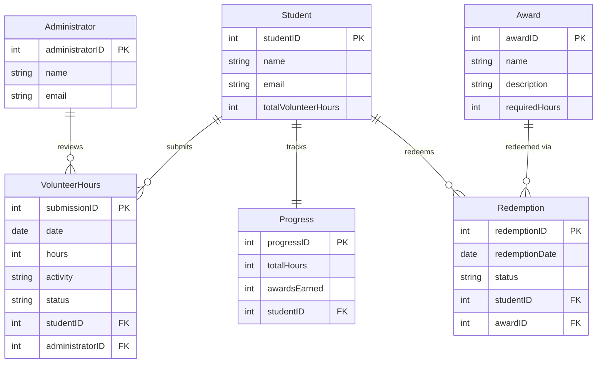

# COMP 3613 Assignment 1

Draft this file with the Guide. **Update it after every phase milestone** before you pause. The use-case diagram is a UML PNG at `docs/diagrams/use-case.png`, linked from this file as `diagrams/use-case.png` (path relative to `docs/report.md`). The model diagram is Mermaid. **Embed wireframe images** as `wireframes/<file>` (files live in `docs/wireframes/`).

Do not put your student ID in this file if you will commit it. The PDF cover adds your name and ID at export time.

## Assigned project

Student Awards (incentive system)

## Three workflows

### 1. Submit volunteer Hours (Student)

### 2. Track Progress and View Leaderboard (Student)

### 3. Redeem Awards (Student)

## Use case diagram

Student and Administrator share **Submit Volunteer Hours** (student submits; administrator approves or rejects). **View Leaderboard** `«extend»`s **Track Progress** (optional). **Redeem Awards** `«include»`s **Track Progress** (always required). Track Progress, View Leaderboard, and Redeem Awards are Student-only.

## Model diagram

Phase 4 revision: removed `Award.points`, `Progress.pointsEarned`, and `Leaderboard.totalPoints` — hours drive rankings and eligibility. Leaderboard is a derived view, not a stored table.

## Wireframes

### Submit Volunteer Hours (Student + Admin)

### Track Progress and View Leaderboard

### Redeem Awards

### Coverage

<!-- student-build:wireframe-coverage
use_case: Submit Volunteer Hours
image: docs/wireframes/wireframe final-1.png
covered: yes
-->

<!-- student-build:wireframe-coverage
use_case: Track Progress and View Leaderboard
image: docs/wireframes/wireframe final-2.png
covered: yes
-->

<!-- student-build:wireframe-coverage
use_case: Redeem Awards
image: docs/wireframes/wireframe final-3.png
covered: yes
-->

## Theming

**Wordmark:** Student Awards (no logo)
**Font:** Inter (professional sans-serif)
**Tone:** Professional but encouraging
**Colors:**
- Navy blue primary (`#1e4d8c` accent, `#0f1b2d` background)
- Neutral surface (`#f4f5f7`) and ink (`#1c2a3a`)
- Green (`#2e7d5b`) for approve actions
- Red (`#c0392b`) for reject actions
- Bronze (`#b07d4f`), Silver (`#9aa5b1`), Gold (`#d4a843`) for award tiers

**Applied to:** landing (`/`), login, register, authenticated sidebar. Brand tokens set in `app/static/css/app.css`. Starter demo pages removed.

## Implementation notes

### Workflow 1: Submit Volunteer Hours (Student)

**Status:** Done

**Implementation notes:**
- SQLModel: `VolunteerHours` model with date, hours, activity, status (default "pending"), student_id FK, administrator_id FK (nullable).
- Thin route: `/app/submit` GET renders form; POST binds form data, constructs Repository + Service, calls `service.submit_hours()`. No SQL in route.
- Service creates submission with status "pending". Admin approve updates status, increments `User.totalVolunteerHours`, creates `Progress` on first approval.
- Model revision: added `totalVolunteerHours` to User (was missing from ERD); added `Progress` model.

**Verify notes:** Student ran app, submitted form via sidebar "Submit Hours" link, received success message. Form matches wireframe.

**Admin approval (completes Workflow 1):** Admin home page shows pending submissions with APPROVE/REJECT buttons (green/red per theming). Approve updates status, increments student hours, creates Progress. Student sees updated hours on Progress page. Verified end-to-end.

### Workflow 2: Track Progress and View Leaderboard (Student)

**Status:** Done

**Implementation notes:**
- Thin routes: `/app/progress` and `/app/leaderboard` construct LeaderboardRepository + LeaderboardService, call service methods, pass results to template. No SQL in routes.
- Leaderboard is derived — repository queries User ordered by totalVolunteerHours, service builds ranked list with is_current flag.
- Progress page shows approved hours, progress bar, "Access Leaderboard" button.
- Leaderboard page shows ranked table with current user highlighted.

**Verify notes:** Student saw 0 approved hours and bob on leaderboard (fresh account). Correct behaviour.

### Workflow 3: Redeem Awards (Student)

**Status:** Done

**Implementation notes:**
- Thin routes: `/app/awards` and `/app/awards/redeem/{award_id}` construct AwardRepository + AwardService, call service methods, redirect after redeem. No SQL in routes.
- Hours stay after redemption — award is a milestone marker (student choice).
- Service checks eligibility (hours >= requiredHours, not already redeemed), creates Redemption, increments Progress.awardsEarned.
- Awards seeded: Bronze (20h), Silver (35h), Gold (50h).
- Template shows REDEEM (gold button) / UNAVAILABLE / REDEEMED states per wireframe.

**Verify notes:** Student saw Bronze as REDEEMED after redeeming. Correct behaviour.

### Polish

- Added "Your Next Milestone" card to Progress page (was missing from wireframe).
- Progress bar now computes the actual next unredeemed award threshold instead of hardcoded 50.
- Fixed: awards were not seeded until re-running `python manage.py init` after adding award seeding to CLI.

## Deployed app

Phase 6. Public Render URL (not localhost). Markers open this to mark the three workflows.

https://

## Logins

Every account a marker needs, including extra users you added. Starter accounts:

- bob / bobpass — regular user
- admin / adminpass — admin

## YouTube URL

## Session transcripts

Filled when the Guide builds the report: the agent writes each Guide chat to `docs/transcripts/<slug>.md` (Copilot Agent, Cursor, or OpenCode). `python manage.py report` packages them. Do not paste chats here during the build.

## Competency (student-judge)

Filled when the report is built. Guide runs student-judge, writes `docs/judge.md`, and export appends the scorecard here.

## Skill integrity

Filled by `python manage.py report`. Do not edit the course skills.
